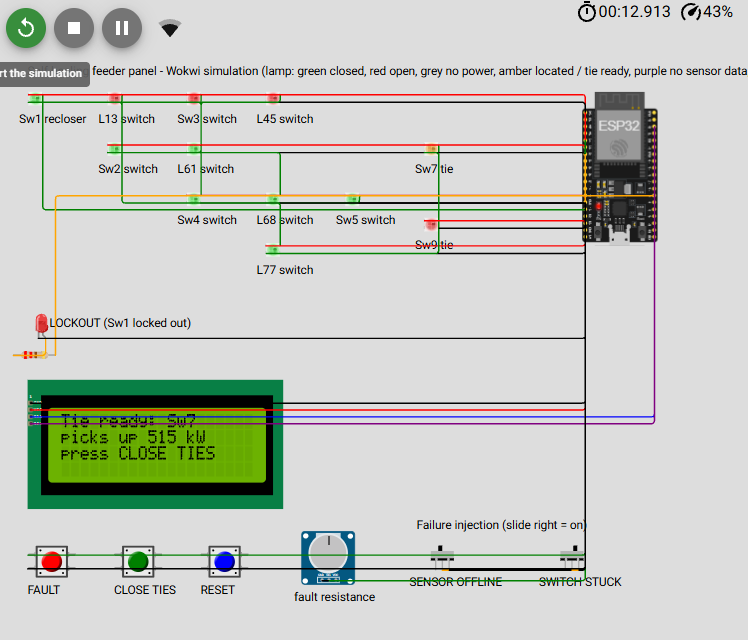

# Control panel board (ESP32, simulated in Wokwi)

**Tool:** [Wokwi](https://wokwi.com) (browser ESP32 simulator), Arduino code.



**What goes here:** a small control panel the study drives over MQTT. It is a mimic board: one RGB lamp per switch, laid out like the feeder's zone tree, plus a lockout lamp, a 20x4 LCD, three buttons, a knob and two failure-injection switches.

| Part | What it does |
|---|---|
| 12 RGB lamps | Sw1 to Sw5, L13 to L77 and the ties Sw7, Sw9. The colours mean: green = closed with power, grey = closed without power, red = open, blinking amber = the zone the model located, or a tie waiting for the operator, purple = that switch's sensor sends nothing, blinking red = the switch is stuck. |
| LOCKOUT lamp | On while the feeder-head recloser Sw1 is locked out. |
| LCD | The current switching step, with the study's numbers (located zone, confidence, kW restored). |
| FAULT button | Asks the study for a line-to-ground fault in a random zone (every zone equally likely), at a random bus inside it. |
| Knob | Picks that fault's resistance, one of the study's values (`config.SLG_RESISTANCES`). |
| CLOSE TIES button | The operator approves closing the planned ties. |
| RESET button | Puts the feeder back to normal. |
| SENSOR OFFLINE switch (slide right) | The next fault arrives with no readings from one switch, picked at random as in the study's missing-sensor test. The model uses the other nine; it was trained for this (sensor dropout), and the LCD shows the study's share of faults located correctly with that sensor missing (`results/metrics.json`). |
| SWITCH STUCK switch (slide right) | The first switch told to open fails to open. The zone on its other side is isolated together with the faulted zone, and the next switches out open instead (`restoration.plan_restoration(..., stuck=...)`); the ties are then checked by power flow as usual. |

Files:

| File | Made by |
|---|---|
| `wokwi/sketch.ino` | Firmware. Hand-written; the same code is meant to run on a real ESP32. |
| `wokwi/diagram.json` | Wiring and lamp layout. Generated from the study's topology: `python scripts/wokwi_diagram.py` |
| `wokwi/libraries.txt` | The Arduino libraries Wokwi installs. |

## Run it

1. On the PC, start the study's side. It needs `models/model.pkl`, so run `python run.py` once first.

   ```bash
   python scripts/panel_bridge.py
   ```

2. Open a new ESP32 project at <https://wokwi.com/projects/new/esp32>. Paste `sketch.ino` and `diagram.json` into the tabs of the same name, and add the four libraries from `libraries.txt` in the Library Manager. Then press the green Start button.
3. Turn the knob to choose a fault resistance, then press FAULT. The lamps and the LCD walk through the switching steps:
   - Sw1 locks out;
   - the model names a zone;
   - isolation;
   - Sw1 re-closes;
   - the ties wait for CLOSE TIES.
4. Press RESET to start again. Slide SENSOR OFFLINE or SWITCH STUCK to the right before FAULT to inject a failure; LCD line 3 shows what is armed.

`python scripts/panel_bridge.py --dry-run --bus 60 --r 25` prints one incident's frames without MQTT.

## Building it for real

[`BOM.md`](BOM.md) lists the parts for a breadboard version (about $71 at 2026-11-20 store prices) and the wiring that differs from Wokwi: a real ESP32 needs level shifting for the 5 V NeoPixels and the 5 V LCD backpack, which Wokwi does not model.

## How it connects

The free Wokwi simulator reaches only the internet, not this computer. The board and `panel_bridge.py` therefore meet on a public test broker (`config.PANEL_BROKER`), with topics `shf/<PANEL_ID>/state` and `shf/<PANEL_ID>/cmd`.

- The messages are simulated panel states, nothing private.
- Anyone can read or write a public topic, so the bridge accepts only the four commands it knows (`shf/panel.py`, `parse_command`).

A real ESP32 would put its own Wi-Fi in `sketch.ino` and point `BROKER` at the local broker from `scada/docker-compose.yml`.

## Limits

Everything here is a simulation. The board is a Wokwi simulation, not field equipment, and it is not connected to a real feeder.

The panel shows what the study computes:

- the OpenDSS fault;
- the zone the trained model picks;
- the restoration plan.

When the model picks the wrong zone, the panel says so and stops. The study does not model what a real scheme would do next.

The stuck switch is a simple back-up rule: the zone behind the stuck switch is isolated as well. It is not modelled in time, so there are no breaker-failure timers and no second trip. With no switch stuck, the plan is exactly the study's plan.
